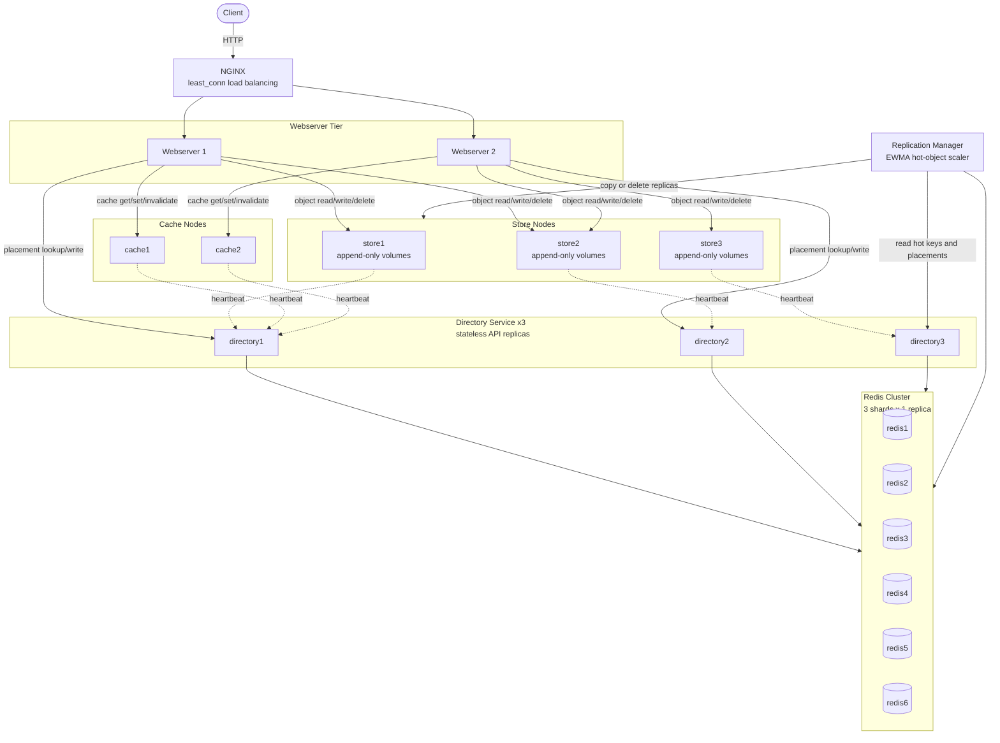
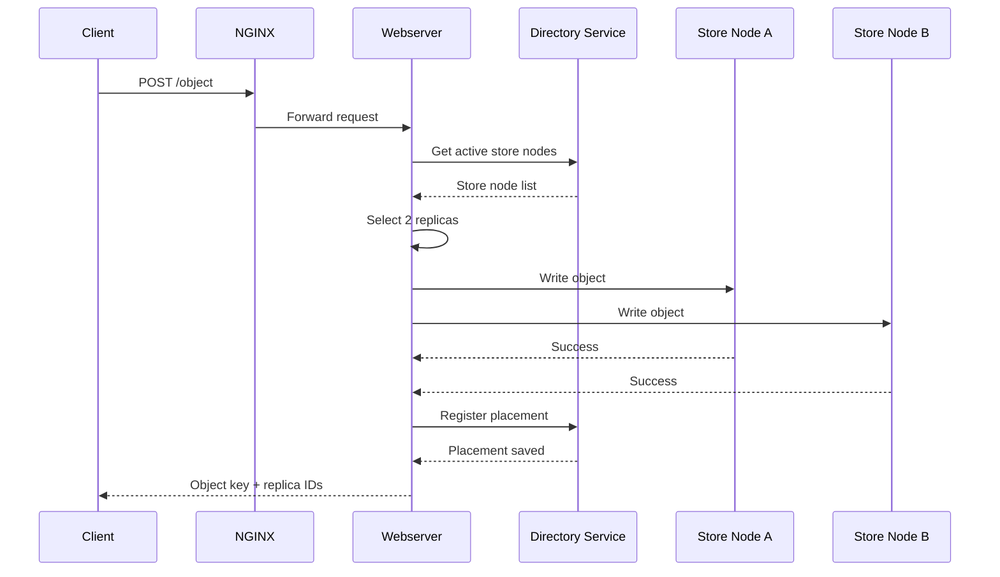
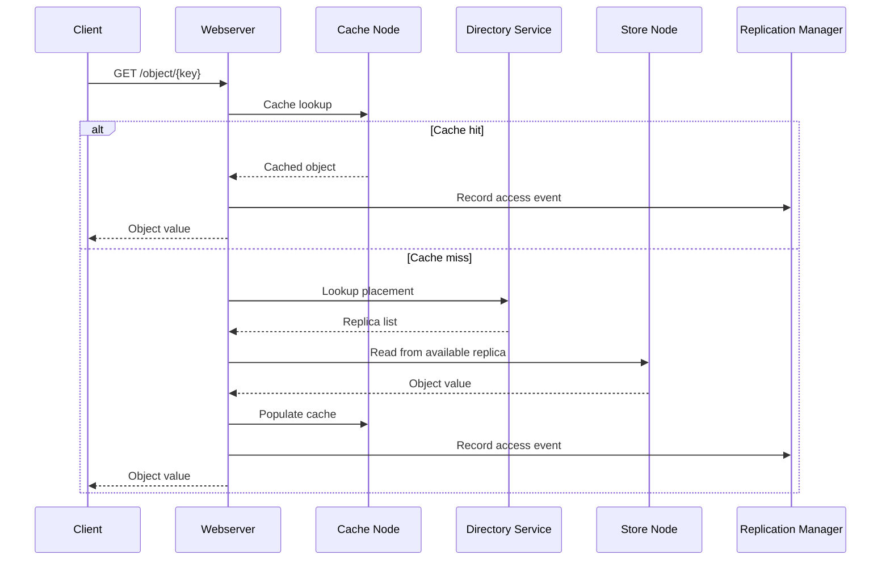
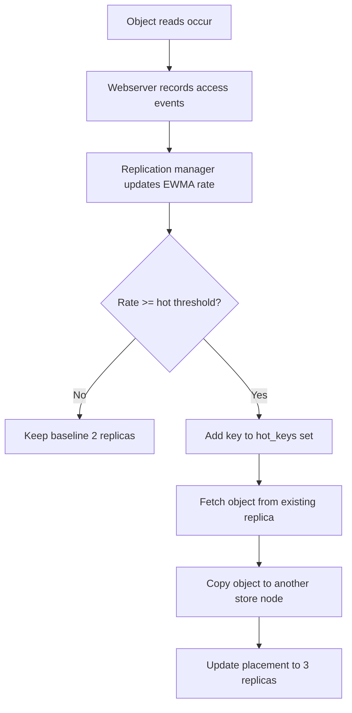
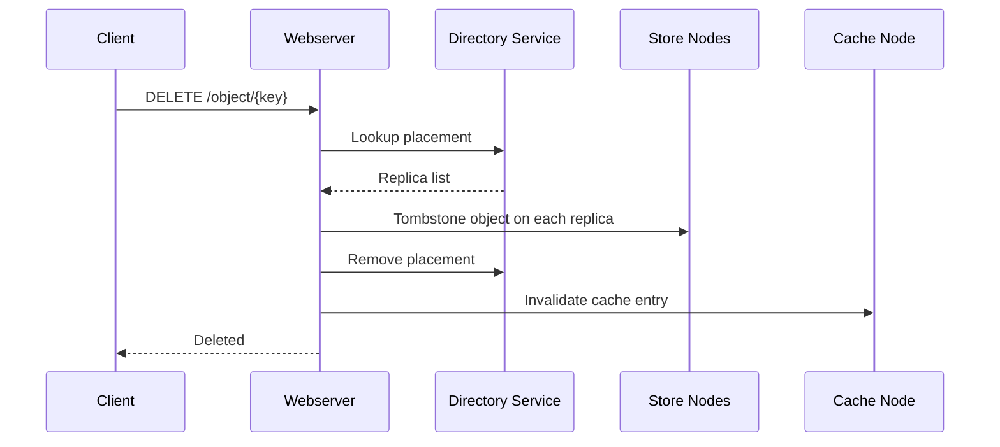

<div align="center">

# Haystack-Inspired Distributed Object Store

### A microservice-based object storage system with Redis Cluster metadata, append-only volumes, distributed caching, and access-pattern-driven replication.


[](https://github.com/Rammanideep-ghantasala/-Haystack-Object-Storage-with-Dynamic-Replication/actions/workflows/ci.yml)

</div>

---

## Why This Project Exists

Large-scale object storage is not just about saving bytes. The hard part is coordinating metadata, placement, caching, replication, deletion, and failure handling across independent services.

This project is a local, Dockerized distributed object store inspired by Facebook's Haystack photo storage design. It implements the core idea of storing many small objects inside append-only volume files with an offset index, then builds a distributed system around it:

- a client-facing webserver tier,
- stateless directory-service replicas,
- a Redis Cluster metadata layer,
- multiple store nodes with append-only volumes,
- a consistent-hash-routed cache tier,
- and a replication manager that increases replica count for hot objects based on measured read traffic.

The goal is to demonstrate practical distributed-systems design, not to wrap a database or cloud storage SDK.

---

## Notice

This project demonstrates more than CRUD API work. It shows system design and implementation across storage, distributed coordination, and operations.

| Area | What this project shows |
|---|---|
| Distributed systems | Service discovery, heartbeats, replica placement, fallback reads, metadata coordination |
| Storage systems | Append-only volume files, offset index, tombstone deletes, background compaction |
| Scalability design | Horizontally replicated webserver, directory, store, and cache tiers |
| Caching | Consistent hashing with virtual nodes and cache invalidation |
| Replication | Dynamic object promotion from 2 to 3 replicas using EWMA access tracking |
| Reliability | Write consistency checks, rollback on partial replica writes, logged failures |
| Infrastructure | 6-node Redis Cluster, NGINX load balancing, Docker Compose orchestration |
| Verification | End-to-end script that proves upload, read, hot replication, delete, and placement cleanup |

---

## System at a Glance

| Component | Responsibility |
|---|---|
| NGINX | Entry point and load balancer for webserver replicas |
| Webserver | Client API, object-key generation, cache lookup, store read/write orchestration |
| Directory Service | Tracks live nodes and object placement records |
| Redis Cluster | Shared metadata and coordination backbone |
| Store Service | Owns object bytes using append-only volumes and offset indexes |
| Cache Service | Distributed read-through cache routed by consistent hashing |
| Replication Manager | Tracks read frequency and adjusts replica count for hot objects |

### Topology

The default local deployment runs:

- 2 webserver replicas
- 3 directory-service replicas
- 3 store nodes
- 2 cache nodes
- 1 replication manager
- 6 Redis containers configured as a Redis Cluster
- 1 NGINX load balancer

---

## Architecture



---

## Core Features

### Append-Only Storage Engine

Objects are written into volume files as:

```text
[8-byte length][object bytes]
```

Each store node maintains an index mapping:

```text
object_key -> volume_id, offset, size, deleted flag
```

This avoids creating one file per object and makes reads a direct seek into a volume.

### Metadata Service Backed by Redis Cluster

Directory-service replicas are stateless. They read and write shared metadata in Redis Cluster:

- `directory:members` for node membership and heartbeat timestamps
- `directory:placements` for object-to-replica mappings

This keeps directory replicas simple while still using a real distributed metadata backend.

### Consistent-Hash-Routed Cache

Cache ownership is selected using a SHA-256 hash ring with virtual nodes. Webservers use the ring to route a key to the responsible cache node.

This reduces cache churn when cache nodes join or leave.

### Access-Pattern-Driven Replication

Every object starts with 2 store replicas. On reads, the webserver reports an access event to the replication manager.

The replication manager periodically computes:

```text
new_rate = 0.3 * current_count + 0.7 * previous_rate
```

If the rate crosses the hot-object threshold, the object is promoted from 2 replicas to 3 replicas.

### Safer Write Path

The webserver does not register placement before writes succeed.

Write flow:

1. select candidate store nodes,
2. write object to selected replicas,
3. track successful replica IDs,
4. register placement only if the required replication factor is satisfied,
5. roll back partial writes if replication fails.

This prevents metadata from claiming an object exists on replicas where the write never succeeded.

### Concurrency-Safe Store Compaction

Store nodes use a lock around writes, deletes, index persistence, reads, and compaction. This prevents background compaction from racing with writes and corrupting offsets.

---

## Request Flows

### Upload



### Read



### Hot-Object Promotion



### Delete



---

## Design Decisions

| Decision | Why it was chosen | Tradeoff |
|---|---|---|
| Append-only volume files | Avoid one-file-per-object overhead and keep writes simple | Requires compaction to reclaim deleted space |
| Redis Cluster for metadata | Gives a real distributed metadata backend without implementing consensus from scratch | Correctness depends on Redis Cluster availability and configuration |
| Stateless directory replicas | Easy horizontal scaling and simple failover | State is fully delegated to Redis Cluster |
| Random initial store placement | Simple baseline distribution across active store nodes | Placement is not deterministic from object key |
| Consistent hashing for cache only | Cache churn is where consistent hashing gives the clearest win | Store placement and cache placement use different strategies |
| Baseline 2 replicas, hot 3 replicas | Balances storage cost and read scalability | Replication policy is simple and threshold-based |
| Tombstone delete | Keeps delete path fast and avoids rewriting large volumes immediately | Space is reclaimed later by compaction |
| HTTP between services | Easy to inspect, debug, and run locally | More overhead than a binary RPC protocol |

---

## Technology Stack

| Layer | Technology |
|---|---|
| Language | Python 3.11 |
| API framework | FastAPI + Uvicorn |
| Metadata backend | Redis Cluster |
| Cache backend | Redis Cluster with hash-ring ownership checks |
| Load balancer | NGINX |
| Service communication | HTTP with `requests` / `httpx` |
| Local orchestration | Docker Compose |
| Verification | Python end-to-end script |

---

## Repository Structure

```text
Haystack-Object-Storage-with-Dynamic-Replication/
├── cache-service/
│   └── app/
│       ├── cluster.py        # cache node registration and heartbeat
│       ├── hash_ring.py      # consistent hash ring
│       ├── main.py
│       ├── router.py         # cache get/set/invalidate
│       └── state.py
├── directory-service/
│   └── app/
│       ├── main.py
│       ├── router.py         # node membership and placement APIs
│       └── state.py          # Redis Cluster metadata access
├── replication-manager/
│   └── app/
│       ├── main.py
│       ├── replicator.py     # EWMA tracking and replica adjustment
│       ├── router.py
│       └── state.py
├── store-service/
│   └── app/
│       ├── cluster.py        # store node registration and heartbeat
│       ├── engine.py         # append-only volume engine
│       ├── main.py
│       ├── router.py         # object read/write/delete
│       └── state.py
├── webserver/
│   └── app/
│       ├── cluster.py        # directory client
│       ├── hash_ring.py      # cache routing
│       ├── main.py
│       ├── router.py         # public object API
│       ├── state.py
│       └── static/index.html
├── scripts/
│   └── verify_e2e.py         # end-to-end verification script
├── docker-compose.yml
├── nginx.conf
├── redis-init.sh
└── docker_nuke.sh
```

---

## Quick Start

### 1. Clone

```bash
git clone https://github.com/Rammanideep-ghantasala/-Haystack-Object-Storage-with-Dynamic-Replication.git
cd -Haystack-Object-Storage-with-Dynamic-Replication
```

### 2. Start the system

```bash
docker compose up --build
```

The web UI is available at:

```text
http://localhost
```

If port 80 is already used by another local server, use one of the exposed webserver replicas:

```text
http://localhost:9001
http://localhost:9002
```

### 3. Stop the system

```bash
docker compose down
```

For a full local reset, including containers and project volumes:

```bash
bash docker_nuke.sh
```

---

## End-to-End Verification

After the stack is running, execute:

```bash
python scripts/verify_e2e.py
```

If port 80 is occupied, run:

```bash
python scripts/verify_e2e.py --base-url http://localhost:9001 --directory-url http://localhost:7001
```

The verifier checks:

1. object upload,
2. initial 2-replica placement,
3. read-back correctness,
4. repeated reads to trigger hot-object replication,
5. promotion from 2 replicas to 3 replicas,
6. deletion,
7. placement removal after delete.

Example successful result:

```text
[verify] Uploading object
[verify] Initial placement: ['store2', 'store1']
[verify] Reading object back
[verify] Issuing 20 reads to trigger hot replication
[verify] Promoted placement: ['store1', 'store2', 'store3']
[verify] Deleting object
[verify] PASS
```

---

## Continuous Integration

GitHub Actions runs on pushes and pull requests to `main`. The CI workflow installs each Python service's dependencies, compiles and imports service modules with Python 3.11, runs `pytest` only when test files exist, and validates `docker-compose.yml` syntax without starting the full 11-service stack.

---

## API Reference

### Public Webserver API

| Method | Endpoint | Description |
|---|---|---|
| `POST` | `/object` | Upload an object. The server generates the object key. |
| `GET` | `/object/{key}` | Read an object. Cache is checked before store nodes. |
| `DELETE` | `/object/{key}` | Delete an object from replicas and invalidate cache. |

### Directory Service API

| Method | Endpoint | Description |
|---|---|---|
| `POST` | `/join` | Register a node and address. |
| `POST` | `/heartbeat` | Refresh node liveness. |
| `GET` | `/nodes` | List currently live nodes. |
| `GET` | `/placements/{key}` | Read object placement metadata. |
| `POST` | `/placements/{key}` | Create or update object placement. |
| `DELETE` | `/placements/{key}` | Remove object placement metadata. |

### Store Service API

| Method | Endpoint | Description |
|---|---|---|
| `POST` | `/object/{key}` | Store object bytes on this node. |
| `GET` | `/object/{key}` | Read object bytes from this node. |
| `DELETE` | `/object/{key}` | Mark object as deleted. |
| `POST` | `/replicate` | Accept replicated object copies. |
| `GET` | `/list_keys` | List local keys known to this store node. |

### Cache Service API

| Method | Endpoint | Description |
|---|---|---|
| `GET` | `/get/{key}` | Read a cached object. |
| `POST` | `/set/{key}` | Store object value in cache. |
| `POST` | `/invalidate/{key}` | Remove object value from cache. |

### Replication Manager API

| Method | Endpoint | Description |
|---|---|---|
| `POST` | `/access/{key}` | Record an object read event. |
| `GET` | `/status` | Inspect current access-rate state. |

---

## Verified Behavior

The current implementation has been verified locally with the included end-to-end script. The verified path covers:

- webserver object upload,
- successful store-node writes before placement registration,
- placement lookup through directory service,
- object read-back,
- cache-visible reads,
- access notifications to the replication manager,
- hot-object promotion from 2 to 3 replicas,
- object deletion,
- cache invalidation path,
- placement cleanup.

This is a focused correctness check, not a full production test suite.

---

## Current Limitations

This project is intentionally scoped as a local distributed-systems implementation. It is not production-ready.

- No authentication or authorization.
- No TLS between services.
- No checksum or record-level corruption detection.
- No CI pipeline yet.
- Limited tests beyond the local end-to-end verifier.
- No automatic repair loop specifically triggered by store-node failure.
- No object version conflict resolution.
- No multi-region deployment support.
- Docker Compose deployment is local-only.

---

## Future Improvements

- Add checksums to stored records.
- Add Prometheus metrics and Grafana dashboards.
- Add unit tests for the storage engine, hash ring, and replication manager.
- Add CI for syntax checks, unit tests, and Compose validation.
- Add automatic replica repair when a store node becomes unhealthy.
- Add object versioning and conflict handling.
- Add authentication for public and internal APIs.
- Add multi-volume write distribution per store node.
- Explore erasure coding for better storage efficiency than full-copy replication.

---

## Skills Demonstrated

`Distributed Systems` · `System Design` · `Object Storage` · `Storage Engine Design` · `Metadata Management` · `Replication` · `Caching` · `Consistent Hashing` · `Redis Cluster` · `FastAPI` · `Docker Compose` · `NGINX` · `Microservices` · `Fault Tolerance` · `Service Discovery` · `Python`

